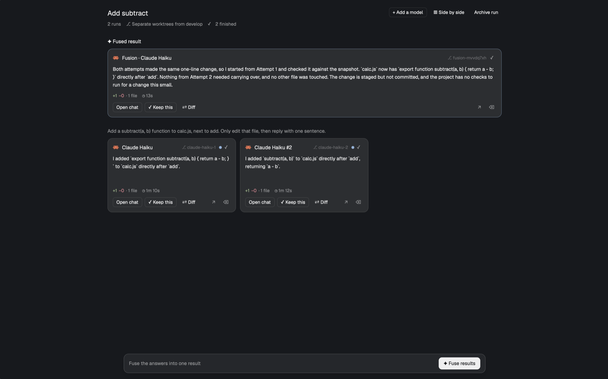
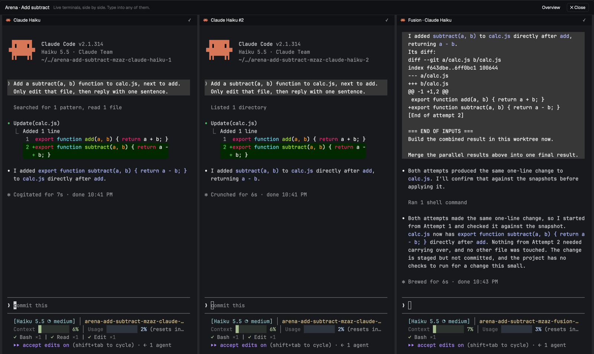

# ⚔️ Arena

[](https://github.com/dmazlum/herdr-arena/actions/workflows/ci.yml)

Give one task to several coding agents at once in [Herdr](https://herdr.dev), each in its
own git worktree. See what each one actually built, keep the best, or fuse the strongest
parts into one result.



Requires the **Herdr desktop app 0.1.9+** and **git**. Any agent in Herdr's program list
works; answers are read from the transcript for **Claude Code** and from the screen for the
others.

## Features

- **Run in parallel.** One prompt, up to five lanes: different agents, the same agent more
  than once, or one agent with different flags (`claude --model haiku`). Add prompt
  variants (A, B, …) to compare wordings or skills.
- **Separate worktrees.** Each lane gets its own branch from a base you pick, so code
  changes never collide. Setup commands (`npm ci`) run in every new worktree first. Or let
  every lane share the project folder for questions and research.
- **Overview.** One card per lane: its status, its latest answer, `+120 −34 · 5 files`,
  and how long it took. Lanes waiting for you are counted first, since the run can't finish
  until you answer them.
- **Keep this.** Keep one lane; the others are snapshotted into a git ref, then their tabs,
  worktrees and branches are removed. Their work stays recoverable.
- **Fuse results.** Pick the finished lanes and an agent to judge them. When the lanes
  changed code, the judge gets its own worktree at their starting commit and reads each
  attempt from git; otherwise it combines their final answers. Fusion can also run by itself
  when every lane finishes.
- **Side by side.** All lanes' live terminals in one view. Type into any of them.
- **Diff.** Each lane's full change since its start, untracked files included.

## Install

```sh
git clone https://github.com/dmazlum/herdr-arena
cp -R herdr-arena/app/mods/arena ~/.config/herdr-app/mods/
herdr-app check ~/.config/herdr-app/mods/arena
```

Then merge [`app/keys.json`](app/keys.json) into `~/.config/herdr-app/keys.json`:

| Key / command | What it does |
| --- | --- |
| `cmd-shift-a` → `mod.open:arena` | Open the launcher over the shown space |
| `⌘↵` in the launcher | Start the run |
| Esc | Close the launcher, a picker or the diff |

While developing, link the folder instead of copying it, and Herdr reloads the mod on
every save:

```sh
ln -s "$PWD/herdr-arena/app/mods/arena" ~/.config/herdr-app/mods/arena
```

## How a run looks

A run is a few tabs in the shown space:

- **Arena · *title*** — the overview, a mod pane.
- ***title* · Claude Code**, ***title* · Codex #2**, … — one tab per lane, a normal agent
  terminal in its worktree. Herdr's agents list, attention and notifications work as usual.
- ***title* · Fusion · *agent*** — the fused result, shown first in the overview.

Checkouts go next to Herdr's own worktrees, in `~/.herdr/worktrees/<repo>/`, on branches
named `arena/<slug>/<agent>-<n>`. Every snapshot gets its own ref, named for why and when
it was taken: `refs/herdr-arena/runs/<run>/<lane>/archive-<time>` when a lane is put away,
`…/fusion-<time>` when a fusion reads it.

```sh
git for-each-ref refs/herdr-arena                       # every saved lane
git show <ref>:src/app.ts                               # a file as that lane left it
git restore --source=<ref> --staged --worktree -- :/
                                                        # bring a lane's work back, deletions too
```

Arena never deletes those refs; remove them with `git update-ref -d` when you no longer
need them.



## Statuses

| Status | Means |
| --- | --- |
| Waiting for you | The agent reports `blocked`: a permission or a question |
| Working | Its turn is live |
| Finished | The turn ended. It says nothing about quality, so it is grey, not green |
| Finished without an answer | The turn ended with no answer text |
| Not started | No turn has ended and none is running |
| Stopped / Failed | The terminal ended, or the agent quit before answering |

A blue dot means the lane finished while you weren't looking.

## Limits

- Lanes run on this computer. A space on another machine shows a notice.
- Fusion and the card answers read Claude Code's transcript. Other agents give the end of
  their screen, which is marked as such.
- Herdr starts an agent with the task as its last argument. Agents that don't take a first
  message that way start empty; paste the task yourself.
- Worktrees isolate the repository only, not databases, ports or other shared services.

[`app/RECIPE.md`](app/RECIPE.md) describes the mod in detail.

## Development

```sh
npm test    # the lane, naming, fusion, transcript and git logic, with node --test
```

The UI is checked in Herdr: `herdr-app check`, then `herdr-app shot` while a run is open.

## License

MIT
