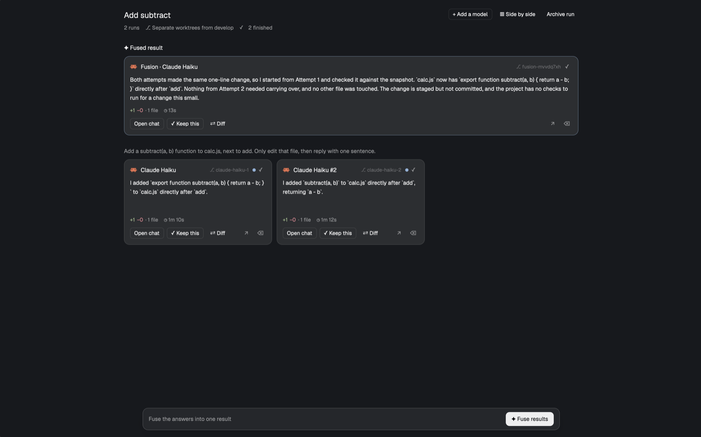

# Arena

Arena hands one task to several coding agents at once, each in its own git worktree,
then lays their results out as cards: status, latest answer, `+ins −del · N files` and
time. You keep the best lane, or fuse the strongest ones into a new result. The others'
work is saved to git refs before their worktrees go.

## What you see

- **Launcher** (`mod.open:arena`, a dialog 760px wide and 86% tall, on `popover`, 18px
  padding):
  - A header: **Run in parallel** (15px semibold), the repo and folder in `dim`. In a tab
    that belongs to a run, a ghost button **Open this run** goes to its overview.
  - A title field (32px, `input` border; placeholder *Parallel run*; left empty, the
    prompt's first line is used).
  - The prompt: a textarea that grows from 5 to 14 rows. With more than one variant, A, B,
    … tabs above it show each variant's run count and an ×; **+ Prompt variant** adds one
    (four at most) with the current prompt and agents copied.
  - Sections titled in 10.5px `dim` capitals:
    - **AGENTS**: one chip per agent (its program icon, its name, `−`, the count, `+`) and
      **+ Add agent**. That opens a list in the dialog: installed agents first, missing ones
      dimmed as *not installed*, then **OR A COMMAND**, a field for any command
      (`claude --model haiku`) that Enter adds. Five lanes at most; at five the button reads
      *5 runs at most*.
    - **WHERE THE RUNS WORK**: two radio cards, *Separate worktrees* and *Project
      directory*, each with a one-line hint. Outside git the first is disabled and a note
      says the runs share the folder.
    - With worktrees only: **BASE BRANCH** (a button `⎇ develop`, opening the local
      branches, the checked-out one first; on a detached HEAD, *HEAD (detached)*) and
      **SETUP COMMANDS** (a 3-row textarea, one command per line).
    - **FUSION**: radio cards *Off* and *Automatic*; with Automatic, *Fuse with* and a
      button that opens the same agent list.
  - A footer above a `border` line: the summary (`3 runs · Separate worktrees · fuses with
    Claude Code`) or the error in `ansi1`, `⌘↵`, a ghost **Cancel** and a solid
    **Run (N)**, dimmed while it can't start.
- **Overview**: the only pane of the run's tab, **Arena · *title***, on `background`.
  Content is centered, 1024px at most, 24px side padding.
  - The title (17px semibold; turns `accent` on hover, click to rename). Under it in
    11.5px `muted`: `N runs` (and `· N prompt variants`), `⎇ Separate worktrees from
    <base>` or `⎇ Shared directory`, one glyph and count per status in the order waiting,
    failed, working, without an answer, stopped, not started, finished, then `✦ Fuses with
    X when all finish`, or `✦ Automatic fusion skipped: <why>`. On the right: **+ Add a
    model** (outline; with several variants it sits on each variant instead), **▥ Side by
    side** and **Archive run** (ghost).
  - **✦ Fused result**: fusion cards, full width, borders in `accent` at 40%.
  - Per variant: its letter chip (with several), the prompt on one line in `muted`, with
    **Show all** / **Show less** in `accent` for long ones, then a grid of cards: as many
    280px-minimum columns as fit, 10px apart.
  - A card: `raised`, 12px radius, 12px padding, 184px tall at least.
    - Its head: the agent's icon, its label in 12.5px semibold (`Claude Code`, `Codex #2`,
      `Claude Code · B`, `Fusion · Claude Code`), `⎇ <branch end>` in `dim`, a 7px `accent`
      dot when it finished unseen, and the status glyph.
    - Its body (12px, clipped at 96px): the latest answer, or what stands in for it. Answers
      read off a terminal screen are drawn in JetBrains Mono, 10.5px.
    - A meta line in 11px `muted`: `+ins` in `ansi2`, `−del` in `ansi1`, `· N files`, or
      *No file changes*, then `◷ 1m 12s`.
    - Buttons: **Open chat**, **✓ Keep this** (settled lanes with a worktree), **⇄ Diff**
      (when files changed), then two icon buttons, `↗` (leave the run) and `⌫` (archive this
      lane), each with a tooltip.
  - A floating bar 16px above the bottom (`popover`, `input` border, 12px radius, shadow,
    896px at most) that says, by priority: *Runs waiting for you: N. The run can't finish
    until you answer them.*, *2 of 3 finished*, *Starting fusion…* or *Fuse the answers into
    one result*. On the right is a solid **✦ Fuse results**, enabled with two finished lanes.
- **Diff** (a dialog, 85% × 85%): a 44px header (icon, label, `⎇ branch · since <commit>`,
  `N files`, **Esc**), then the unified diff in the terminal font at 11.5px: 26px file rows
  on `raised`, 20px lines numbered, `+` rows tinted `ansi2`, `−` rows `ansi1`, hunks on
  `hover`.
- **Side by side** (a dialog, 96% × 92%): a 40px bar on `chrome` with **Arena · *title***,
  *Live terminals, side by side. Type into any of them.*, **Overview** and **✕ Close**, then
  one column per live lane: a 28px head (icon, label, status glyph) over its terminal.

## How it behaves

- **Agent statuses.** Each card goes by its terminal and the agent's report:
  - `working` → *Working*: the glyph spins (`⠋⠙⠹…` every 90ms in `working`), the body reads
    *Working…* (or the live screen for agents without a transcript) and the time counts up.
  - `blocked` → *Waiting for you*: `!` in `blocked`, *Waiting for you to go on. Open the chat
    to answer.*, and the bar names how many wait.
  - `done` → *Finished*, `✓` in `muted` (grey, never green: it says the turn ended, not that
    the work is good), with the `accent` dot until you look at that tab.
  - `idle` → *Finished* once a turn has ended; before the first turn, *Not started* (`◷`).
  - No agent reported yet and no turn: *Not started*, whether setup commands are running
    (`sh -c …`) or the agent is starting (`zsh -ic …`). Once only a bare shell is left at
    its prompt, the agent quit: *Stopped* (`■`), or *Finished without an answer* (`⚠` in
    `working`) if a turn ended. A terminal that ended: *Stopped*, or *Failed* (`✕` in `ansi1`)
    with an error code.
- **Launch.** ⌘↵ (Ctrl+Enter) or **Run (N)**, both checked the same way: not on another
  machine, a space and folder, a repo looked up, an agent, text in every variant, a fuse
  agent when Automatic. The run is saved, then its overview tab, then one lane at a time:
  `git worktree add -b arena/<slug>/<agent>-<n> ~/.herdr/worktrees/<repo>/<branch with
  dashes> <base commit>`, then `tab.new` with the lane's folder, the agent's argv (wrapped
  as `sh -c 'set -e; <setup>; exec "$@"'` when there are setup commands) and the prompt as
  its `task`. A folder inside the repo (`git rev-parse --show-prefix`, so symlinks don't
  matter) runs in the same folder of each worktree; one missing from the base commit runs
  at the top, with a notice. A lane that fails removes its empty worktree; the others
  start. If none start, the run and its tab are taken back and the launcher stays open with
  the error. The overview tab is shown last.
- **Reading a lane.** Once a second the overview compares each lane's terminal state, turn
  count and agent status. When they move and the lane isn't working, it reads the answer
  and the changes. A read with no answer text yet, or a failed one, is tried again every 3
  seconds, 4 times at most: an agent can report done before its answer is written. A read
  from an earlier turn never decides a status.
  - Answer: for Claude Code, `hc get` gives the foreground pid, `~/.claude/sessions/<pid>.json`
    the session and cwd, and the tail of `~/.claude/projects/<cwd, non-alphanumerics as
    "-">/<session>.jsonl` the newest text message of the last turn (found by session id if
    that folder isn't there). The path is kept, so the answer stays after the agent quits.
    Other agents: the end of `hc read`, marked *screen*.
  - Changes: a copy of the worktree's index (its stat cache spares hashing every file),
    `git add -A` into it, `write-tree`, then `git diff --numstat <start> <tree>`. Untracked
    files count; the real index is never touched.
- **Clicks and keys.** **Open chat** selects the lane's tab and focuses its terminal. The
  title renames the run and every tab of it. Hovering a card raises its border to `input`.
  Launcher: Esc closes an open list first, then the dialog. Diff: Esc or `q` closes.
- **Keep this** turns the bar into *Keep <name>? The other N runs are archived and their
  worktrees removed. Their work stays recoverable.* with **Cancel** and **Keep and clean
  up**. Every other member's tab is closed at once and each agent awaited (herdr-core must
  say it ended; 8s at most, else it is left alone). Then, one by one, its worktree is saved
  (`commit-tree` of that tree onto its HEAD, at `refs/herdr-arena/runs/<run>/<lane>/
  archive-<time>`), removed with `--force`, and its branch deleted. A worktree someone
  already deleted is pruned from git; its branch stays. The kept tab takes the run's title,
  the run is forgotten and the overview closes. A member that fails stays as it was, named
  in a notice.
- **Archive** (`⌫` on a card, or **Archive run**): the same steps. A run left with one
  member is no longer a run: that tab takes the title and the overview closes. **↗** only
  renames the tab and takes it out of the run; its branch number stays taken.
- **Fuse results** turns finished cards into checkboxes, all checked (an unchecked one dims
  to 60%, cards that can't be chosen to 40%), and the bar into
  *Fuse with [agent]*, the mode (*Works in its own worktree and reads each run with git* or
  *Combines the final answers*), *N of M selected*, **Cancel** and **Start fusion** (two at
  least). Each source's answer is read again; a failed read stops the fusion; a lane with
  neither an answer nor changes is left out.
  - Code mode, when every source has a worktree and one changed files: each is snapshotted
    (`…/<lane>/fusion-<time>`, its own ref), and the judge gets a worktree on
    `arena/<slug>/fusion-<time>` at the run's base commit, opened at the repo's top. Its task:
    how to read attempts with git, to bring one in with `git restore --source=<snapshot>
    --staged --worktree -- :/` (deletions too), to port the best of the others, not to
    commit, and to say what it took; then the task, and each attempt's snapshot, changes and
    final answer. Diffs are inlined only when their changed lines (×12 tokens) and their
    bytes (÷4) both fit a tenth of a 200k context; the task is kept under 256 KB.
  - Answers mode: the judge gets the task and the answers, in a worktree of its own at the
    base commit when the run uses worktrees, else in the project folder.
  - The fusion's tab is shown, and its card appears under **✦ Fused result**.
- **Automatic fusion** waits until the lanes have all started, every lane has settled, and
  every lane's last read is of its current turn and final. With two finished it fuses them,
  once. With fewer, the header and a notice say why (*only one run finished with an answer
  (1 finished, 1 failed).*) and it stops waiting.
- **+ Add a model** opens the agent list over the overview and starts one more lane on that
  variant with the same prompt.
- **Side by side** opens the dialog of live terminals; its heads show the overview's status
  for each lane.

## Built from

- One mod, `mods/arena/`. `main.js` picks a shape from `props()`: none → the launcher
  (`launcher.js`); `{ run }` → the overview (`overview.js`, the pane of
  `tab.new {mod: "arena", props: {run}}`); `{ diff: { run, member } }`, `{ bar: run }` and
  `{ head: { run, member } }` → `panels.js` (the diff dialog, and the side-by-side bar and
  heads, as blocks of an overlay layout: a column of a 40px bar block, then a row of
  columns, each a 28px head block over `{ terminal: "<address>" }`).
- `store.js` keeps runs in `shared("arena.runs")` (persisted, and every copy redraws on a
  change), the launcher's last choices in `shared("arena.last")`, and the lane statuses each
  overview publishes for the side-by-side heads in `shared("arena.status")`.
- `actions.js` makes tabs through `herdr-app do tab.new <json>`, which answers with the tab
  and terminal it made (`run()` returns nothing). Lane ids come from a counter on the run,
  never reused.
- `lib/` is plain JavaScript with no Herdr imports, tested by `node --test`: lane status and
  read retries, names, argv and command parsing, the fusion prompts, transcript parsing, the
  diff rows and the git steps.
- `ui.js` draws buttons, status glyphs, agent icons (the app's program table: `svg` when
  `tint`, else `image`), chips, checkboxes and radio cards. No art of its own.
- herdr calls: `terminals()`, `agents()`, `spaces()`, `panes()`, `focused()`,
  `knownAgents()`, `exec`, `hc`, `readTextFile`, `openOverlay`, `closeOverlay`, `notify`,
  `shared`, `setShared`, and `run("tab.select" | "tab.close" | "tab.rename" | "pane.focus")`.
- Programs it runs: `git`, `env`, `cp`, `mktemp`, `rm`, `test`, `find`, `tail`, `sleep`,
  `hc` and `herdr-app`.

## Watch out

- It reaches outside its folder: it creates worktrees and branches in your repo, writes
  `~/.herdr/worktrees`, reads `~/.claude`, and starts agents. It never deletes snapshot refs.
- `line_height(n)` takes a multiplier: `line_height(17)` pushes card text out of sight.
- `⚔` isn't in the UI font: tab names are plain text.
- A mod copy in an overlay ends with the overlay, its tasks with it; a pane's copy starts
  only when its tab is first shown.
- Terminal addresses aren't decimal (`t1c`), so don't parse them as numbers.
- The overview tab exists before its lanes: anything that judges "all lanes" must wait
  for the launch to finish (`launching` on the run).
- Claude Code can report `done` before its last answer reaches the transcript, so a read
  needs retries.
- `git checkout <snapshot> -- .` keeps files an attempt deleted; restore with `:/`.
- `exec` stops a program after 30s: setup commands run in the lane's terminal, not in the
  mod.
- `setShared(key, null)` keeps the key: keep per-run data inside one key.
- Lanes run on this computer only. Answers are read for Claude Code; other agents give their
  screen.

## Done when

- `herdr-app check ~/.config/herdr-app/mods/arena` passes.
- `mod.open:arena` in a git repo, two agents, **Run (2)**: two worktrees under
  `~/.herdr/worktrees/<repo>/`, an **Arena · *title*** tab and a tab per lane, the overview
  shown.
- With a `sleep 6` setup command, the cards read *Not started* until the agents start.
- When both finish, each card shows its answer, `+N −M · K files` and a time.
- **Fuse results** → **Start fusion** adds a **Fused result** card working in its own
  worktree, at the repo's top.
- **Keep this** on one card leaves its worktree only; `git for-each-ref refs/herdr-arena`
  lists the others' snapshots, and their tabs are gone.
- With Automatic fusion and a question that changes no files, the fusion starts by itself
  once both lanes answer, in a worktree of its own.
