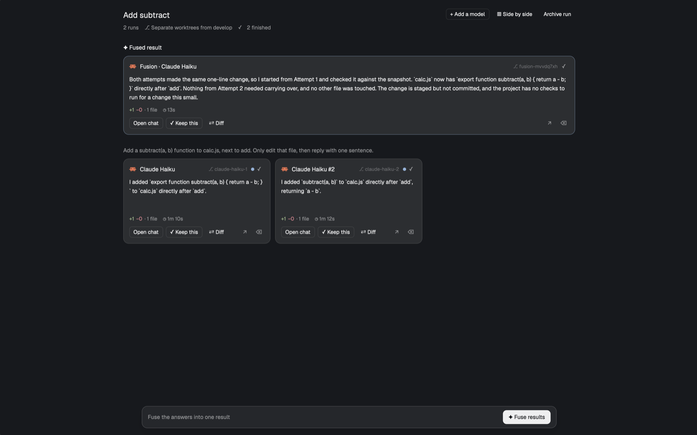

# Arena

Arena gives one task to several coding agents at once, each in its own git worktree, and
shows their results side by side so you can keep the best one or fuse several into one.

## What you see

- **Launcher** (`mod.open:arena`, a 760px dialog on `popover`):
  - **Run in parallel** and the repo and folder it starts from. In a tab that belongs to a
    run, **Open this run** goes to its overview.
  - A title field (empty: the prompt's first line), the prompt, and **+ Prompt variant**
    (up to four, shown as A, B, … tabs with their run counts and ×).
  - **AGENTS**: one chip per agent with `−`, the count, `+`; **+ Add agent** lists the
    app's agents (installed first) and a field for any command. Five lanes at most.
  - **WHERE THE RUNS WORK**: *Separate worktrees* or *Project directory* (outside git only
    the second). With worktrees: **BASE BRANCH** (local branches, the current one first)
    and **SETUP COMMANDS**.
  - **FUSION**: *Off* or *Automatic*, with the agent that fuses.
  - Footer: the summary (`3 runs · Separate worktrees · fuses with Claude Code`) or the
    error, `⌘↵`, Cancel and **Run (N)**.
- **Overview** (the only pane of the run's **Arena · *title*** tab, on `background`):
  - The title (click to rename; renames every tab of the run), then `N runs`, `⎇ Separate
    worktrees from <base>` or `Shared directory`, a count per status in the order waiting,
    failed, working, without an answer, stopped, not started, finished, and `✦ Fuses with
    X when all finish`. On the right: **+ Add a model**, **▥ Side by side**, **Archive run**.
  - **✦ Fused result**: fusion cards, full width.
  - Per variant: its chip (with several), the prompt on one line (**Show all** / **Show
    less**), and a grid of 280px-minimum cards.
  - A card (`raised`, 12px radius, 184px tall at least): the agent's icon and label, the
    branch, an unread dot and the status glyph (working spins). The latest answer (or what
    stands in for it), then `+ins −del · N files` or `No file changes`, and `◷ 1m 12s`.
    Buttons: **Open chat**, **✓ Keep this** (settled lanes with a worktree), **⇄ Diff**
    (when files changed), then `↗` (leave the run) and `⌫` (archive this lane).
  - A floating bar at the bottom: *Runs waiting for you: N…*, *2 of 3 finished*, or *Fuse
    the answers into one result*, with **✦ Fuse results** (two finished lanes at least).
    Keep turns it into a confirmation; Fuse turns the cards into checkboxes and the bar into
    *Fuse with [agent]*, the mode, *N of M selected*, Cancel and **Start fusion**.
- **Diff** (a dialog, 85%): the lane's unified diff since its start, with file headers,
  line numbers and `+`/`−` rows in `ansi2`/`ansi1`.
- **Side by side** (a dialog, 96%×92%): a bar with the run's title, **Overview** and
  **✕ Close**, and one column per live lane: its head (icon, label, status) over its
  terminal.

## How it behaves

- **Launch.** The run is saved first, then its overview tab, then one lane at a time: `git
  worktree add -b arena/<slug>/<agent>-<n> ~/.herdr/worktrees/<repo>/<branch> <base
  commit>`, then `tab.new` with the lane's folder, the agent's argv (wrapped in
  `sh -c '<setup>; exec "$@"'` when there are setup commands) and the prompt as `task`. A
  folder inside the repo (`git rev-parse --show-prefix`, so symlinks don't matter) runs in the same folder of each worktree; a folder the base commit doesn't have runs at the top, with a notice. If no lane starts, the run and its tab are taken back and the launcher stays open with the error. A lane that fails to
  start removes its empty worktree; the others still start. The overview is shown last.
- **Reading a lane.** About once a second the overview compares each lane's terminal state,
  turn count and agent status. When they change, and the lane isn't working, it reads the
  lane's answer and changes. A read with no answer text yet, or a failed one, is tried again
  every 3 seconds, up to 4 times, since an agent can report done before its last answer is
  written. A read from before the current turn is never used for the lane's status.
  - Answer: for Claude Code, `hc get` gives the foreground pid, `~/.claude/sessions/<pid>.json`
    gives the session and cwd, and the tail of
    `~/.claude/projects/<cwd>/<session>.jsonl` gives the newest text message of the last
    turn. The path is kept on the lane, so the answer stays after the agent quits. Other
    agents: the end of `hc read`, marked `screen`.
  - Changes: a throwaway index (`GIT_INDEX_FILE`), `git add -A`, `write-tree`, then `git
    diff --numstat <start> <tree>`. Untracked files count; the real index is never touched.
  - Time: from the lane's start to the end of its last turn, live while it works.
- **Keep.** For every other member: snapshot (`commit-tree` of that tree onto its HEAD,
  stored at `refs/herdr-arena/runs/<run>/<lane>/archive-<time>`), then `git worktree
  remove --force` and `git branch -D`. Every tab is closed first and every agent awaited
  together, so cleanup takes one wait, not one per lane. A failing step leaves that member
  as it was and is reported. A worktree someone already deleted is pruned from git; its
  branch stays.
  Then the kept tab gets the run's title, the run is forgotten and its overview closes.
- **Archive** a lane or the run: the same steps for those members. A run left with one
  member is no longer a run: that tab gets the title and the overview closes. **↗** only
  renames the tab and removes it from the run.
- **Fusion.** Each chosen lane's answer is read again; a read failure stops the fusion, a
  lane without an answer is left out. If every source has a worktree and one changed files,
  each is snapshotted, the judge gets a worktree on `arena/<slug>/fusion-<time>` at their
  starting commit, starts at the worktree's top (it works across the whole repo), and gets a prompt with the task, each attempt's snapshot, changes and final
  answer (and the diffs, when their lines and their bytes both fit a tenth of a 200k context). It brings an attempt in with `git restore --source=<snapshot> --staged --worktree -- :/`, which takes deletions too. Otherwise the
  judge gets the answers, in its own worktree at the lanes' starting commit when the run
  uses worktrees (your checkout stays untouched), or in the project folder when the run
  shares it. Automatic fusion is claimed on the run before it starts, so it runs once:
  when every lane has settled, every lane's last read is of its current turn and final, and
  two have finished. With fewer it says so in the header and a notice, and stops waiting.
- **Add a model** starts one more lane on that variant with the same prompt.

## Built from

- `mods/arena/main.js` picks a shape from `props()`: none → `launcher.js`, `{ run }` →
  `overview.js`, `{ diff }`, `{ bar }`, `{ head }` → `panels.js`.
- `store.js` keeps runs in `shared("arena.runs")`, so every copy redraws on a change, and
  the launcher's last choices in `shared("arena.last")`.
- `actions.js` does everything structural through `herdr-app do <command> <json>`, which
  answers with the tab and terminal it made (`run()` returns nothing).
- `lib/` is plain JavaScript with no Herdr imports, tested by `node --test`: lane status,
  names and argv, the fusion prompts, transcript parsing and git.
- herdr calls used: `terminals()`, `agents()`, `spaces()`, `panes()`, `focused()`,
  `knownAgents()`, `exec`, `hc`, `readTextFile`, `openOverlay`, `closeOverlay`, `notify`,
  `shared`, `setShared`, and `run("tab.select" | "tab.close" | "tab.rename" | "pane.focus")`.
- Programs it runs: `git`, `env`, `mktemp`, `rm`, `tail`, `hc`, `herdr-app`.

## Watch out

- It reaches outside its folder: it creates worktrees and branches in your repo, writes
  `~/.herdr/worktrees`, reads `~/.claude`, and starts agents.
- `--force` removal drops uncommitted work, which is why every removal is preceded by a
  snapshot; a snapshot that fails stops the removal.
- Snapshot refs are never deleted by Arena.
- `exec` has a 30s limit: setup commands therefore run in the lane's terminal, not in the
  mod.
- Lanes run on this computer only.

## Done when

- `herdr-app check ~/.config/herdr-app/mods/arena` passes.
- `mod.open:arena` in a git repo, two agents, **Run (2)**: two worktrees under
  `~/.herdr/worktrees/<repo>/`, an **Arena · *title*** tab and one tab per lane.
- When both finish, their cards show the answer, `+N −M · K files` and a time.
- **Fuse results** → **Start fusion** adds a **Fused result** card in its own worktree.
- **Keep this** on one card leaves one worktree, `git for-each-ref refs/herdr-arena`
  lists the others, and their tabs are gone.
